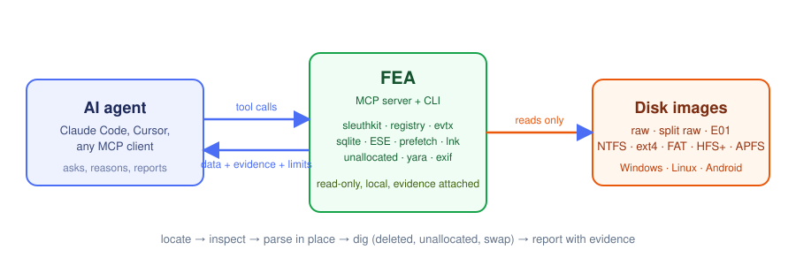

<p align="center">
  
</p>

<h1 align="center">FEA</h1>
<p align="center"><b>One MCP for digital forensics across disk images, file systems and artefacts.</b></p>

<p align="center">
  <a href="https://github.com/keyuraghao/fea/actions/workflows/ci.yml"></a>
  
  
  <a href="LICENSE"></a>
</p>

FEA (Forensic Evidence Agent) lets an AI agent such as Claude Code examine forensic disk images the way an examiner does: list and recover files, read registry hives and event logs, query SQLite and ESE databases, parse prefetch and shortcuts, sweep unallocated space, and build timelines. Everything is read-only, runs locally, and every answer comes back with the evidence behind it (image, partition, path, inode, hash, tool) and its limitations.

It is the forensic counterpart of [REA](https://github.com/morluto/rea), which does the same for reverse engineering.

## Targets

| Target | What FEA does with it | Backed by |
|---|---|---|
| Raw, split raw (`.001`...) and E01 images | partition table, file-system probing, raw and block reads | The Sleuth Kit (pytsk3) |
| NTFS, FAT/exFAT, ext2/3/4, HFS+, APFS, UFS, ISO9660, YAFFS2 | list, find (incl. deleted names), stat with NTFS `$FILE_NAME` times and alternate data streams, read, extract, timeline, recover deleted | pytsk3; `fls`/`tsk_recover` when installed |
| Unallocated space | keyword search (UTF-8 and UTF-16LE), block mapping, block reads | NTFS `$Bitmap` walk; `blkls`/`blkcalc` when installed |
| Windows registry | key/value dumps with last-write times; UserAssist, ShellBags, WordWheelQuery, TypedPaths, USBSTOR, services, timezone and more | regipy |
| Windows event logs (`.evtx`) | filter by event ID, time, provider or text; flattened event data | evtx (Rust parser) |
| Prefetch, LNK and Jump List entries | run counts and times, target paths, volume serials, machine IDs | libscca, liblnk |
| ESE databases (SRUM, Windows Search, WebCache, ntds.dit) | table listing and row dumps | dissect.esedb |
| SQLite (browsers, chat apps, Android) | schema, read-only SQL, WAL applied, freelist size | sqlite3 |
| Pictures, documents, PDFs | metadata, hashes, entropy, bytes after the end-of-file marker, OOXML hidden text and tracked changes, YARA | exiftool or Pillow, puremagic, yara-python |
| Memory remnants on disk (pagefile, hiberfil, swap) | strings and keyword hits with offsets | pure Python |

Linux and Android file systems are handled by the same file-system tools; Android app databases go through the SQLite tools.

## Quick start

```bash
git clone https://github.com/keyuraghao/fea && cd fea
uv sync                                   # or: pip install -e .
uv run fea setup                          # registers the MCP server with Claude Code and installs the /fea skill
uv run fea images add E4 /cases/x/disk.001 --label "Workstation of J. Hassan"
```

Then ask Claude Code something like *"on E4, who cleared the Security log and what ran in the ten minutes before?"* and it will call the FEA tools itself. From the shell the same operations are one command each:

```bash
fea evtx E4 /Windows/System32/winevt/Logs/Security.evtx --ids 1102
fea timeline E4 --start 2021-02-03T12:24 --end 2021-02-03T12:34 --path Prefetch
fea prefetch E4 /Windows/Prefetch/UPDATE2.EXE-7783C67A.pf
```

Requirements: Python 3.12+ on Windows, macOS or Linux. Nothing else. The Sleuth Kit and exiftool binaries are optional accelerators and are used automatically when found (`fea doctor` shows what was detected).

## How an investigation flows

1. **Scope**: `images_list`, `partitions`, `tools_status`.
2. **Locate**: `find` (names, including deleted), `ls`, `timeline`.
3. **Inspect**: `stat` (timestomp indicator from `$FILE_NAME`), `read`, `extract`, `file_info`.
4. **Parse in place**: registry, event logs, prefetch, LNK, ESE, SQLite, EXIF, OOXML, YARA.
5. **Dig**: `grep_files`, `grep_file` on pagefile/hiberfil, `grep_unallocated`, `recover_deleted`, `block_read`.
6. **Report**: every result carries `evidence` and `limitations`; times are given in UTC and the image's timezone.

Long scans run as background jobs (`job_result(job_id, wait_s=30)`), so the agent can keep working.

## Showcase

Findings reproduced with FEA on a ten-image training case (a government leak investigation):

- **Who cleared the logs.** `evtx` on `Security.evtx` returned the single surviving record: event 1102, log cleared by the local account `jean` at 12:34:08 local time; `timeline` on the Prefetch folder showed the implant runs in the preceding minutes; `prefetch` gave the five run times of `update2.exe`.
- **What the implant talked to.** `grep_file` on the implant found `tcp://192.168.2.42:5555` stored as UTF-16LE at offset 205,372.
- **What the user was told to do.** `sqlite_query` on the Sticky Notes database, with its write-ahead log applied, returned the note "install new software with the .\jean" that explains the passwordless local account.
- **Hidden appended data.** `file_info` on every picture reported `bytes_after_eof: 0`, closing a steganography question in one call per file.

## Agent integration

`fea setup` registers the server for Claude Code (user scope) and writes the `/fea` skill. For any other MCP client, point it at:

```
uv --directory /path/to/fea run fea mcp          # or: python -m fea mcp
```

The server speaks stdio by default (`--transport sse|streamable-http` also available).

## Documentation

- [Installation](docs/installation.md): uv, pip, Windows notes, optional native tools
- [CLI reference](docs/cli.md)
- [MCP contract](docs/mcp.md): every tool, its parameters and result shape (generated from the server)
- [Targets](docs/targets.md): per-artefact guides and the Windows/Linux/Android checklists
- [Evidence contract](docs/evidence.md): what the `evidence` and `limitations` blocks promise
- [Contributing](CONTRIBUTING.md), [Security and evidence handling](SECURITY.md), [Changelog](CHANGELOG.md)

## Limits

- The Sleuth Kit does not parse HPFS or some exotic file systems; use `disk_read` and `strings` there.
- Volume shadow copies, BitLocker and encrypted containers are not opened.
- Registry transaction logs are not replayed.
- Without sleuthkit, `grep_unallocated` on non-NTFS volumes scans allocated blocks too (the result says so).

## License

MIT. Third-party libraries keep their own licences: The Sleuth Kit (IBM Public License / CPL), regipy (MIT), evtx (MIT/Apache-2.0), libyal libraries (LGPL), dissect (AGPL-3.0 for dissect.esedb), yara-python (BSD/Apache-2.0). See [THIRD_PARTY_NOTICES.md](THIRD_PARTY_NOTICES.md).
